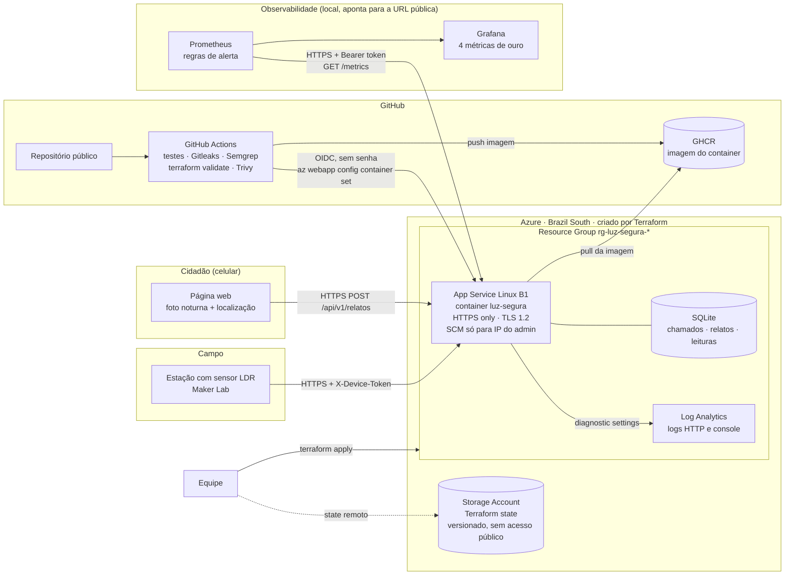

# Arquitetura, responsabilidade compartilhada, LGPD e custo

## 1. Diagrama da arquitetura

### Fluxo do produto dentro da API

1. O cidadão envia a foto e a localização. A API valida o tipo e o tamanho do arquivo, a coordenada e o território do piloto, e aplica rate limit.
2. O classificador analisa a foto **só em memória** e devolve `inexistente`, `fraca` ou `adequada`. A imagem é descartada logo depois. Hoje o classificador é uma heurística de luminância; o modelo da disciplina de Visão entra no lugar dele mantendo a mesma interface.
3. Deduplicação: um relato a até 50 m de um chamado ativo é agrupado nele. Se a mesma foto chegar de novo (comparada por hash perceptual), é rejeitada com 409.
4. Prioridade explicável: severidade + número de relatos + parada de ônibus próxima (ponderada pelo fluxo noturno) + idade do chamado + validação do LDR. Cada ponto vem com o motivo em texto.
5. A estação LDR envia a leitura em lux. A API **confirma** o chamado (sobe a prioridade) ou **contesta** (baixa a prioridade e manda para revisão humana).
6. A equipe de manutenção muda o status com um token de administrador, e o tempo médio entre relato e conserto vira indicador.

## 2. Modelo de responsabilidade compartilhada (PaaS: Azure App Service)

| Camada | Azure | Equipe Luz Segura | Como a equipe cumpre |
|---|---|---|---|
| Datacenter, rede física, hardware | ✅ | | |
| Hipervisor, SO do host, runtime do App Service | ✅ | | |
| Disponibilidade da plataforma e do balanceador | ✅ | | |
| Terminação TLS e certificado `*.azurewebsites.net` | ✅ | Configurar | `https_only = true`, `minimum_tls_version = "1.2"` |
| Controle de rede de entrada | Fornece o recurso | Configurar | SCM/Kudu com `Deny` por padrão e liberado só para `admin_cidr` (a validação no Terraform proíbe `0.0.0.0/0`), FTP desligado, publicação básica desligada |
| Identidade e acesso | Fornece o Entra ID | Configurar | Deploy por OIDC com o papel *Website Contributor* restrito ao RG, sem senha guardada no GitHub. Tokens de admin, dispositivo e métricas com 24+ caracteres |
| **Imagem do container** (SO base e bibliotecas) | | ✅ | Multi-stage, usuário não root, `apt-get upgrade`, pip removido, Trivy barrando HIGH/CRITICAL |
| **Código da aplicação** | | ✅ | Testes, Semgrep, validação de entrada, SQL parametrizado, headers de segurança e CSP |
| **Segredos** | Cofre (App Settings criptografados) | ✅ | GitHub Secrets, `.tfvars` e state fora do repositório, Gitleaks no pipeline |
| **Dados (LGPD)** | Criptografia em repouso | ✅ | Minimização (ver seção 3) |
| **Monitoramento e resposta** | Métricas da plataforma | ✅ | Prometheus, Grafana e 5 regras de alerta |

## 3. Onde ficam os dados pessoais (LGPD)

| Dado | É dado pessoal? | Onde fica | Por quanto tempo | Proteção |
|---|---|---|---|---|
| Foto enviada | Pode ser (rostos, placas) | **Em lugar nenhum**: é processada em memória e descartada | Milissegundos | A imagem é reduzida para 256 px antes da análise e o EXIF (GPS do aparelho, modelo do celular) nunca é lido nem salvo |
| Localização do relato | Sim (indireto) | SQLite no App Service, região Brazil South | Enquanto o chamado existir | Arredondada para 4 casas decimais (cerca de 11 m) e não ligada a nenhuma identidade |
| Hash perceptual da foto | Não permite reconstruir a imagem | SQLite | Enquanto o chamado existir | Usado só para deduplicar |
| IP do cidadão | Sim | Memória da API (rate limit). **Também nos logs HTTP da plataforma Azure** | Memória: 60 s. Log Analytics: 30 dias. Logs do App Service: 7 dias | A API não loga IP. O acesso aos logs fica restrito ao RG. Base legal: segurança do serviço (legítimo interesse) |
| Nome, telefone, e-mail, CPF | Sim | **Não são coletados** | | Minimização por design |
| Tokens (admin, dispositivo, métricas) | Credenciais | App Settings (criptografados) e Terraform state remoto | Até a rotação | Nunca ficam no código nem na imagem |
| Leituras do LDR | Não | SQLite | Enquanto o chamado existir | |

**Direitos do titular:** como o relato não carrega identificação, não há como ligar um registro a uma pessoa. Pedidos de exclusão de um ponto específico são atendidos pelo canal da prefeitura.

**Evolução para produção:** guardar os tokens no Azure Key Vault usando Key Vault references, migrar para o Azure Database for PostgreSQL com private endpoint e definir uma política formal de retenção.

## 4. Estimativa de custo mensal

Os valores são de referência para Linux pay-as-you-go em USD e devem ser **confirmados na [Calculadora de Preços do Azure](https://azure.microsoft.com/pricing/calculator/)** na região escolhida.

| Item | Configuração | US$/mês (MVP) |
|---|---|---|
| App Service Plan | Linux **B1** (1 vCPU, 1,75 GB), 1 instância | ~13,14 em East US. Brazil South é mais caro; estimar ~17 a 21 |
| Log Analytics | PerGB2018, retenção de 30 dias, teto diário de 0,5 GB | ~0 a 2 (volume baixo, a franquia gratuita mensal cobre) |
| Storage Account (Terraform state) | Standard LRS, poucos KB | < 0,10 |
| Tráfego de saída | Bem abaixo da franquia gratuita mensal | 0 |
| GitHub Actions + GHCR | Repositório e pacote públicos | 0 |
| Prometheus + Grafana | Rodando local | 0 |
| **Total MVP** | | **~US$ 14 a 23/mês**, coberto pelo crédito de US$ 100 do Azure for Students |

**Projeção para um piloto real** (um bairro de Osasco, com prefeitura ou concessionária pagando): App Service **S1** com 2 instâncias (escala e slots de deploy), Azure Database for PostgreSQL Flexible **B1ms**, Key Vault e Azure Front Door com WAF. Ordem de grandeza: **US$ 150 a 250/mês**, a confirmar na calculadora. Isso entra no modelo B2G do pitch.

**Controles de custo já no Terraform:** plano B1 fixo, teto diário de ingestão no Log Analytics e budget opcional com alerta em 80% do valor previsto (`email_alerta_orcamento`). Para zerar o custo quando o MVP não estiver em uso: `az webapp stop` ou `terraform destroy`.
